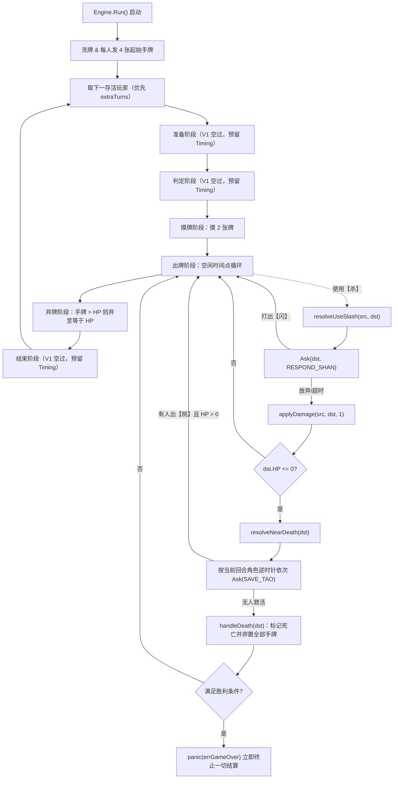

# 三国杀游戏引擎 V1 设计文档

## 1. V1 目标与范围边界

V1 的目标是在现有 `ws` + `room` + `handler` 架构之上，跑通**最小可玩的完整对局闭环**，同时为 V2（武将技能/时机系统）和 V3（锦囊/装备/身份局）预留干净的扩展骨架。

### 1.1 V1 包含内容
- **开局与结束**：房主在房间内发起开始游戏（人数 `2 ~ 10`）；默认采用简化胜负规则（**最后 1 名存活玩家获胜**，底层抽象为 `WinCondition` 接口，后续可无痛切换标准身份局）。
- **基础牌堆**：仅包含 3 种基本牌——**【杀】、【闪】、【桃】**；支持自动洗牌与牌堆空时重洗弃牌堆。
- **6 阶段回合骨架**：严格按《三国杀官方规则集 3.0》搭建 `准备 → 判定 → 摸牌 → 出牌 → 弃牌 → 结束` 骨架，预埋 `Timing` 钩子位（V1 钩子默认空跑）。
- **核心嵌套结算**：
  - 出牌阶段空闲时间点循环（默认每回合限用 1 次【杀】，受伤时可用【桃】回血，随时可结束出牌）
  - 使用【杀】 → 询问目标出【闪】 → 扣减体力 → 濒死（`HP <= 0`）→ 按当前回合角色逆时针依次求【桃】 → 死亡弃牌 → 立即胜负检查（任意时刻终止一切结算）
- **交互与托管**：服务端 `Ask` 阻塞询问模型（带超时默认处理）；局内玩家掉线自动托管，所有人掉线自动终止牌局防止协程泄漏。
- **视野隔离**：每位玩家仅收到自己的具体手牌，其他玩家仅下发手牌数量（`hand_count`）。

### 1.2 V1 暂不包含（留给 V2 / V3）
- 武将选择与武将技能
- 锦囊牌、装备牌、距离/攻击范围限制（V1 默认全场互相可【杀】，预留 `CanTarget()` 钩子）
- 翻面、铁索连环、属性伤害、身份牌隐藏与亮身份

---

## 2. 与现有项目的模块集成

```text
sanguogao/
├── proto/          # 扩展对局相关 Protobuf 消息
├── model/          # 生成的 Go 协议代码
├── ws/             # 无需改动，继续复用 Send / SendMany
├── room/           # 扩展房间状态 WAITING / PLAYING，持有当前牌局引用
├── game/           # 【新增】游戏引擎核心包（单局单协程）
│   ├── card.go     # 卡牌与牌堆（洗牌、摸牌、弃牌）
│   ├── state.go    # 玩家、回合、阶段、Timing 定义
│   ├── engine.go   # 单局主循环、Ask 交互、嵌套结算、胜负中断
│   └── rules.go    # WinCondition 等可扩展规则接口
├── handler/        # 新增 StartGameReq / GameActionReq 路由与回调绑定
└── main.go
```

### 模块协作关系
1. 房间处于 `WAITING` 时，走现有房间逻辑（加入、离开、改名）。
2. 房主发 `StartGameReq` → `room` 校验人数 ≥ 2 并切换为 `PLAYING` → 创建 `game.Engine` 并启动独立 goroutine `go engine.Run()`。
3. 游戏进行中：
   - 禁止新玩家加入该房间（返回 `ROOM_PLAYING`）。
   - 玩家发 `GameActionReq` → `handler` 转发给 `engine.SubmitAction(clientID, req)`。
   - 玩家 WS 掉线 → 通知 `engine.MarkOffline(clientID)` 进入托管，不再从座次移除；若全房离线则关闭 `engine` 并销毁房间。
4. 游戏结束：`engine` 广播 `GameOverPush` 并回调 `room` 将状态恢复为 `WAITING`（离线玩家此时清理出房间），方便留存玩家直接开下一局。

---

## 3. 核心数据结构（`game` 包）

### 3.1 卡牌与牌堆

```go
type CardType int32

const (
    CardSha  CardType = 1 // 杀
    CardShan CardType = 2 // 闪
    CardTao  CardType = 3 // 桃
)

type Suit int32 // 黑桃/红桃/梅花/方片

type Card struct {
    ID     uint32   // 本局内唯一卡牌 ID（前端操作以 ID 为准）
    Type   CardType
    Suit   Suit
    Number int32    // 1~13
}

type Deck struct {
    drawPile    []*Card
    discardPile []*Card
}
```
- V1 默认牌堆配比（共 54 张，节奏紧凑）：【杀】30 张、【闪】15 张、【桃】9 张。
- `Draw(n)`：牌堆不足时自动将 `discardPile` 洗牌补充到 `drawPile`。

### 3.2 牌局玩家与回合上下文

```go
type GamePlayer struct {
    ID        string
    Name      string
    Seat      int     // 座次 0..N-1（逆时针顺序）
    HP        int32   // 当前体力
    MaxHP     int32   // 体力上限（V1 默认 4）
    Hand      []*Card // 手牌
    Alive     bool
    Offline   bool    // 是否掉线（掉线后自动托管）
    SlashUsed int     // 本回合出牌阶段已使用【杀】次数
}

type Phase int32

const (
    PhasePrepare Phase = 1 // 准备阶段
    PhaseJudge   Phase = 2 // 判定阶段
    PhaseDraw    Phase = 3 // 摸牌阶段
    PhasePlay    Phase = 4 // 出牌阶段
    PhaseDiscard Phase = 5 // 弃牌阶段
    PhaseFinish  Phase = 6 // 结束阶段
)

type TurnContext struct {
    Player  *GamePlayer
    Phases  []Phase
    Skipped map[Phase]bool // 为 V2/V3 跳过阶段预留
}
```

### 3.3 引擎主体与并发模型

```go
type Engine struct {
    roomCode string
    players  []*GamePlayer
    deck     *Deck

    currentSeat int
    extraTurns  []*GamePlayer // 为 V2/V3 额外回合预留
    currentTurn *TurnContext

    // 单协程输入通道（外部仅通过这两个 channel 与引擎交互）
    actionCh  chan IncomingAction
    offlineCh chan string
    stopCh    chan struct{}

    // 当前挂起的询问（用于校验回包合法性）
    nextAskID uint64

    // 输出回调（由 handler 注入，负责 Protobuf 封装与 WS 下发）
    onSendState func(playerID string, state *model.GameStatePush)
    onSendAsk   func(playerID string, ask *model.GameAskPush)
    onBroadcast func(playerIDs []string, pkt *model.Packet)
    onGameOver  func(winnerID string)
}
```

> **核心并发原则**：整个 `Engine` 内部所有状态（`players`、`deck`、`currentTurn`）**只由 `Run()` 所在的单个 goroutine 读写**，局内零锁竞争；外部 `handler` 只往 `actionCh` / `offlineCh` 投递消息。

---

## 4. 状态机与核心结算流程

### 4.1 主流程与嵌套结算



### 4.2 全局胜负中断机制
依据规则集最后一条：
> **任何时候，一旦满足了游戏结束的条件，则终止一切结算，结束游戏，宣布胜利方。**

实现方式：
- 定义内部错误类型 `type errGameOver struct { winner *GamePlayer }`。
- `Engine.Run()` 顶部注册 `defer`，`recover()` 到 `errGameOver` 后广播 `GameOverPush` 并执行收尾回调（其他非预期 panic 正常重新抛出）。
- 每次 `handleDeath` 结束后调用 `g.checkWinCondition()`，若只剩 ≤ 1 名存活玩家，直接 `panic(errGameOver{...})` 瞬间跳出任意深度的嵌套结算。

### 4.3 `Ask` 同步阻塞询问机制

每次需要玩家决策时调用统一方法 `askPlayer(target, askType, timeout, extra)`：

1. 生成递增 `askID`（`g.nextAskID++`）。
2. 先向所有玩家推送最新 `GameStatePush`（视野隔离），再向 `target` 发送 `GameAskPush`（含 `askID`、操作类型、超时时间、上下文参数）。
3. 若 `target.Offline == true`，直接返回“默认操作”（跳过/放弃/自动弃牌），不白等超时。
4. 否则进入 `select` 循环等待：
   - 收到 `stopCh` → 退出协程。
   - 收到 `offlineCh`（若正好是当前被询问人掉线）→ 立即执行默认操作。
   - 收到超时 `timer.C` → 执行默认操作。
   - 收到 `actionCh`：
     - 校验 `act.ClientID == target.ID` 且 `act.AskID == askID`（不匹配直接丢弃，防止旧询问的迟到包串扰）。
     - 校验业务合法性（如卡牌是否在手牌中、目标是否存活、出杀次数是否超限、弃牌数量是否等于 `X`）。
     - **合法**：返回该操作，主流程继续推进。
     - **非法**：向该玩家回发带错误码的 `GameActionResp`，继续 `select` 等待（不消耗剩余时间）。

各 `AskType` 的超时默认行为：
| AskType | 触发时机 | 超时 / 离线默认行为 |
| --- | --- | --- |
| `ASK_PLAY` | 出牌阶段空闲时间点 | 结束出牌阶段（`PASS`） |
| `ASK_RESPOND_SHAN` | 成为【杀】的目标 | 不出【闪】（`PASS`），承受伤害 |
| `ASK_SAVE_TAO` | 有角色处于濒死状态 | 不出【桃】（`PASS`），询问下一人 |
| `ASK_DISCARD` | 弃牌阶段手牌超出上限 | 自动弃置手牌末尾的 `X` 张牌 |

---

## 5. Protobuf 协议扩展草案

在现有 [message.proto](file:///Users/apple/Programming/Go/sanguogao/proto/message.proto) 的 `Packet.payload` 中追加以下消息：

### 5.1 新增错误码
- `ERROR_CODE_NOT_HOST`：非房主无权开始游戏
- `ERROR_CODE_NOT_ENOUGH_PLAYERS`：房间人数不足（至少 2 人）
- `ERROR_CODE_ROOM_PLAYING`：房间已开始游戏，无法加入
- `ERROR_CODE_INVALID_ACTION`：非法出牌/响应操作

### 5.2 新增消息体

```protobuf
// 开局请求（仅房主）
message StartGameReq {}
message StartGameResp {
  ErrorCode code = 1;
  string message = 2;
}

// 卡牌视图
enum CardType {
  CARD_TYPE_UNSPECIFIED = 0;
  CARD_TYPE_SHA = 1;
  CARD_TYPE_SHAN = 2;
  CARD_TYPE_TAO = 3;
}

message CardInfo {
  uint32 id = 1;
  CardType type = 2;
  int32 suit = 3;    // 1黑桃 2红桃 3梅花 4方片
  int32 number = 4;  // 1~13
}

// 玩家公开状态（不含手牌明细）
message GamePlayerPublic {
  string id = 1;
  string name = 2;
  int32 seat = 3;
  int32 hp = 4;
  int32 max_hp = 5;
  int32 hand_count = 6;
  bool alive = 7;
  bool offline = 8;
}

// 个人视角牌局快照（视野隔离）
message GameStatePush {
  string room_code = 1;
  string current_turn_player_id = 2;
  int32 phase = 3;                       // 1准备 2判定 3摸牌 4出牌 5弃牌 6结束
  int32 draw_pile_count = 4;
  int32 discard_pile_count = 5;
  repeated GamePlayerPublic players = 6; // 全员公开信息
  repeated CardInfo self_hand = 7;       // 仅当前接收者的手牌
  string waiting_player_id = 8;          // 当前正在等待谁操作
}

// 询问类型
enum AskType {
  ASK_TYPE_UNSPECIFIED = 0;
  ASK_TYPE_PLAY = 1;         // 出牌阶段空闲点
  ASK_TYPE_RESPOND_SHAN = 2; // 响应【杀】出【闪】
  ASK_TYPE_SAVE_TAO = 3;     // 濒死求【桃】
  ASK_TYPE_DISCARD = 4;      // 弃牌阶段弃牌
}

// 服务端向指定玩家发起操作询问
message GameAskPush {
  uint64 ask_id = 1;
  AskType ask_type = 2;
  int32 timeout_sec = 3;
  int32 discard_count = 4;    // ASK_DISCARD 时需要弃置的张数
  string source_player_id = 5; // ASK_RESPOND_SHAN(杀来源) / ASK_SAVE_TAO(濒死角色)
  int32 slash_remaining = 6;   // ASK_PLAY 时本回合剩余可用【杀】次数
}

// 玩家操作类型
enum ActionType {
  ACTION_TYPE_UNSPECIFIED = 0;
  ACTION_TYPE_USE_CARD = 1; // 出牌（杀/闪/桃）
  ACTION_TYPE_DISCARD = 2;  // 弃牌
  ACTION_TYPE_PASS = 3;     // 放弃响应 / 结束出牌
}

// 客户端提交操作
message GameActionReq {
  uint64 ask_id = 1;
  ActionType action_type = 2;
  repeated uint32 card_ids = 3;
  string target_id = 4; // 使用【杀】时指定目标
}

message GameActionResp {
  ErrorCode code = 1;
  string message = 2;
}

// 公共战报推送（用于前端展示文字战报/动画）
message GameEventPush {
  string text = 1; // 如 "游客_A1B2 对 游客_C3D4 使用了【杀】"
}

// 游戏结束推送
message GameOverPush {
  string winner_id = 1;
  string winner_name = 2;
}
```

---

## 6. 为 V2 预留的扩展钩子

在 V1 的 `engine.go` 中提前定义空钩子，V2 接入武将技能时无需重构主流程：

1. **Timing 触发点**：在 `runTurn` / `execPhase` / `applyDamage` / `handleDeath` 关键节点保留 `g.trigger(timing, ctx)` 调用点。
2. **数值修正点**：
   - 摸牌数通过 `g.getDrawCount(p)` 获取（V1 返回 `2`，V2 可叠加【英姿】/【好施】）。
   - 手牌上限通过 `g.getMaxHandCards(p)` 获取（V1 返回 `max(0, p.HP)`，V2 可叠加【克己】/【权计】等）。
   - 出杀次数上限通过 `g.getSlashLimit(p)` 获取（V1 返回 `1`，V2 可叠加【诸葛连弩】/【咆哮】）。
3. **动态阶段与额外回合**：`TurnContext.Skipped` 和 `Engine.extraTurns` 已就位。

---

## 7. 测试验证计划

1. **引擎单元测试（`game/engine_test.go`）**：不依赖网络，直接用模拟通道驱动 `Engine` 测试：
   - 正常回合流转（摸牌 → 出杀 → 出闪抵消 → 结束出牌 → 弃牌 → 下家回合）。
   - 杀命中 → 扣血 → 濒死求桃救活 → 再次击杀触发 `GameOverPush` 立即中断结算。
   - 牌堆抽空自动重洗弃牌堆。
   - 超时托管与掉线自动托管。
2. **Web 联调扩展**：在现有 [web/index.html](file:///Users/apple/Programming/Go/sanguogao/web/index.html) 增加“开始游戏”按钮和简版牌桌视图（自己手牌 + 目标选择 + 响应弹窗 + 战报区），两个浏览器标签页即可完整对打一局。
