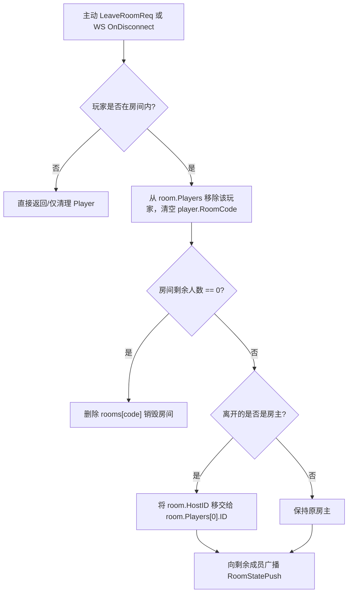

# 房间管理器后端设计文档

## 1. 需求与目标

实现一个基于 WebSocket + Protobuf 的轻量级房间管理系统，满足以下核心能力：

1. **连接与昵称**：用户连接 WS 后可设置自己的名字；在房间外或房间内均支持修改名字。
2. **创建房间**：系统随机生成 6 位字母+数字房间号（大小写不敏感），创建者自动成为房主。
3. **加入房间**：输入房间号加入对应房间，加入后可看到房间内所有成员。
4. **实时同步**：房间内发生变动（成员加入、离开、改名、房主变更）时，服务端通过 WS 主动推送最新房间成员信息给房内所有客户端。
5. **自动退出**：支持主动离开房间；当客户端 WS 掉线时，自动退出所在房间并通知房内其他人，房间无人时自动销毁。

---

## 2. 模块划分与职责

保持分层清晰，业务与网络传输解耦：

```text
sanguogao/
├── proto/          # Protobuf 协议定义
├── model/          # protoc 生成的 Go 结构体
├── ws/             # 连接管理层：维护在线连接、读写循环、底层发送、断线回调
├── room/           # 房间业务层：管理玩家与房间的内存状态（不直接依赖 websocket.Conn）
├── handler/        # 协议路由层：反序列化 Packet -> 调用 room -> 通过 ws 推送结果
└── main.go         # 组装依赖并启动服务
```

### 各层边界
- **`ws` 层**：负责连接生命周期、单播 `Send(clientID, data)`、批量推送 `SendMany(clientIDs, data)`，向上暴露两个回调：`OnMessage(clientID, data)` 和 `OnDisconnect(clientID)`。
- **`room` 层**：纯内存状态机，只处理“玩家/房间”逻辑并返回状态快照与待通知的 `clientID` 列表，**不直接执行网络 IO**。
- **`handler` 层**：将 `ws` 回调与 `room` 串起来，负责 Protobuf 编解码与消息分发。

---

## 3. 核心数据结构

### 3.1 `ws` 层（对现有 `ws/manager.go` 的最小扩展）

在现有连接/断开基础上，为 `Client` 增加带缓冲的发送队列与写协程，避免并发写和慢客户端阻塞：

```go
type Client struct {
    ID     string
    Conn   *websocket.Conn
    send   chan []byte        // 发送缓冲队列（如容量 64）
    ctx    context.Context
    cancel context.CancelFunc
}
```

- `readLoop`：读到二进制消息后触发 `OnMessage(c.ID, data)`；出错/断开时退出并触发 `OnDisconnect(c.ID)`。
- `writeLoop`：从 `send` channel 取数据写入 `Conn`；队列满时非阻塞丢弃或断连保护。

### 3.2 `room` 层

```go
// Player 表示一个在线连接对应的玩家状态
type Player struct {
    ID       string // 与 ws.Client.ID 一致
    Name     string // 昵称
    RoomCode string // 当前所在房间号（空字符串表示未在房间中）
}

// Room 表示一个房间
type Room struct {
    Code       string    // 6 位大写房间号
    HostID     string    // 房主 Player.ID
    Players    []*Player // 房内玩家列表（按加入顺序排列，前端展示顺序稳定）
    MaxPlayers int       // 房间人数上限（0 表示不限制，可默认设如 8）
    CreatedAt  time.Time
}

// RoomManager 房间管理器
type RoomManager struct {
    mu      sync.RWMutex
    rooms   map[string]*Room   // key: 6 位大写房间号
    players map[string]*Player // key: ClientID，快速查玩家昵称和所在房间
}
```

---

## 4. 房间号生成规则

- **长度**：6 位。
- **大小写不敏感**：服务端统一转大写存储；加入房间时对用户输入做 `strings.ToUpper(strings.TrimSpace(input))`。
- **字符集**：剔除易混淆字符（`0`/`O`、`1`/`I`/`L`），使用 32 字符表：
  ```text
  ABCDEFGHJKMNPQRSTUVWXYZ23456789
  ```
  总组合数 $32^6 \approx 1.07 \times 10^9$，碰撞概率极低。
- **随机与防碰撞**：使用 `crypto/rand` 生成，在持有写锁插入 `rooms` 时检查是否已存在，若冲突则重试（最多 10 次）。

---

## 5. Protobuf 协议设计

沿用现有 [message.proto](file:///Users/apple/Programming/Go/sanguogao/proto/message.proto) 的 `Packet` + `oneof` 封包方式。

### 5.1 设计原则
- **请求-响应匹配**：复用 `Packet.seq`，服务端回包原样带回 `seq`，方便前端按序号对应请求；服务端主动推送时 `seq = 0`。
- **房间同步采用全量快照**：每次房间内有人加入、离开、改名、房主变更，统一推送 `RoomStatePush`（完整房间信息与成员列表）。相比增量事件，全量快照实现简单、前端直接覆盖渲染、不存在状态漂移问题。

### 5.2 消息定义草案

```protobuf
syntax = "proto3";

package model;

option go_package = "github.com/Frankhuex/sanguogao/model;model";

enum ErrorCode {
  ERROR_CODE_OK = 0;
  ERROR_CODE_INVALID_PARAM = 1;    // 参数不合法（如名字为空或超长）
  ERROR_CODE_ROOM_NOT_FOUND = 2;   // 房间不存在
  ERROR_CODE_ROOM_FULL = 3;        // 房间已满
  ERROR_CODE_ALREADY_IN_ROOM = 4;  // 已在某个房间中
  ERROR_CODE_NOT_IN_ROOM = 5;      // 当前不在任何房间中
  ERROR_CODE_INTERNAL = 99;        // 服务端内部错误
}

message Packet {
  uint64 seq = 1;
  oneof payload {
    // 基础心跳
    Ping ping = 10;
    Pong pong = 11;

    // 客户端请求 & 服务端响应
    SetNameReq set_name_req = 20;
    SetNameResp set_name_resp = 21;

    CreateRoomReq create_room_req = 22;
    CreateRoomResp create_room_resp = 23;

    JoinRoomReq join_room_req = 24;
    JoinRoomResp join_room_resp = 25;

    LeaveRoomReq leave_room_req = 26;
    LeaveRoomResp leave_room_resp = 27;

    // 服务端主动推送
    WelcomePush welcome_push = 49;
    RoomStatePush room_state_push = 50;
  }
}

message Ping { int64 ts = 1; }
message Pong { int64 ts = 1; }

// 通用视图结构
message PlayerInfo {
  string id = 1;
  string name = 2;
}

message RoomInfo {
  string code = 1;
  string host_id = 2;
  repeated PlayerInfo players = 3;
}

// 1. 设置/修改昵称
message SetNameReq {
  string name = 1;
}
message SetNameResp {
  ErrorCode code = 1;
  string message = 2;
  PlayerInfo self = 3;
}

// 2. 创建房间
message CreateRoomReq {
  // 预留：后续可扩展 max_players、房间配置等
}
message CreateRoomResp {
  ErrorCode code = 1;
  string message = 2;
  RoomInfo room = 3;
}

// 3. 加入房间
message JoinRoomReq {
  string room_code = 1;
}
message JoinRoomResp {
  ErrorCode code = 1;
  string message = 2;
  RoomInfo room = 3;
}

// 4. 主动离开房间
message LeaveRoomReq {}
message LeaveRoomResp {
  ErrorCode code = 1;
  string message = 2;
}

// 5. 连接成功欢迎推送（告知服务端分配的 id 和默认昵称）
message WelcomePush {
  PlayerInfo self = 1;
}

// 6. 房间状态变更推送（成员加入/离开/改名/房主变更）
message RoomStatePush {
  RoomInfo room = 1;
}
```

---

## 6. 核心业务流程与边界处理

### 6.1 连接建立（`OnConnect`）
- 服务端为新连接统一生成唯一 `ClientID`（随机短 ID / Hex，不依赖客户端传参，彻底避免伪造或撞 ID）。
- 在 `RoomManager.players` 中注册该玩家，自动分配默认昵称（如 `游客_XXXX`，取 ID 后 4 位）。
- 立即向该客户端下发一次 `WelcomePush`，让前端拿到自己的 `id` 和默认 `name`。

### 6.2 设置 / 修改名字（`SetName`）
1. 对 `name` 做 `TrimSpace`，校验长度（`1 ~ 16` 个 Unicode 字符，用 `utf8.RuneCountInString` 计算）；允许房内同名。
2. 更新 `player.Name`。
3. 回复 `SetNameResp`。
4. **联动推送**：若该玩家当前在房间内（`player.RoomCode != ""`），生成房间快照并向房内**其他成员**推送 `RoomStatePush`。

### 6.3 创建房间（`CreateRoom`）
1. 校验玩家当前不在其他房间中（否则返回 `ERROR_CODE_ALREADY_IN_ROOM`）。
2. 生成唯一 6 位大写房间号，创建 `Room`（`MaxPlayers = 10`），将玩家加入 `room.Players` 并设为 `HostID`，更新 `player.RoomCode`。
3. 回复 `CreateRoomResp`（内含完整 `RoomInfo`）。

### 6.4 加入房间（`JoinRoom`）
1. 校验玩家当前不在其他房间中（已在同一房间可直接幂等返回或报 `ALREADY_IN_ROOM`）。
2. 将输入的 `room_code` 去空格并转大写，查找 `rooms[code]`；不存在返回 `ERROR_CODE_ROOM_NOT_FOUND`。
3. 校验房间人数上限；已满返回 `ERROR_CODE_ROOM_FULL`。
4. 将玩家追加到 `room.Players`，更新 `player.RoomCode`。
5. 向当前玩家回复 `JoinRoomResp`（含最新 `RoomInfo`），同时向房内**其他成员**广播 `RoomStatePush`。

### 6.5 离开房间 & 掉线自动退出（`LeaveRoom` / `OnDisconnect`）

主动退房与 WS 掉线共用核心逻辑：



- **掉线额外动作**：`OnDisconnect` 在完成退房后，还需从 `RoomManager.players` 中删除该 `ClientID`，防止内存泄漏。
- **幂等性**：即使同时触发主动退房和断线，也保证只移除一次、不 panic。

---

## 7. 并发安全设计

- **单锁原子更新**：`RoomManager` 使用一把 `sync.RWMutex` 保护 `rooms` 和 `players` 两张表，保证“修改玩家 `RoomCode`”与“修改 `room.Players`”始终原子一致。
- **锁外发消息（关键原则）**：
  - 所有网络发送（`ws.Send` / `ws.SendMany`）都**必须在释放 `RoomManager.mu` 之后执行**。
  - 做法：`room` 的业务方法在锁内构造好不可变的快照（`*model.RoomInfo`）和目标 `[]string`（待推送的 `clientID` 列表），解锁后返回给 `handler`，由 `handler` 统一序列化一次 `[]byte` 并调用 `ws` 发送。
  - 好处：彻底避免锁内阻塞网络 IO，也杜绝与 `ws.Manager.mu` 交叉加锁导致死锁。

---

## 8. 已确认的设计决策

1. **未设昵称策略**：采用默认昵称（连上 WS 自动分配如 `游客_XXXX`），允许直接建房/进房，随时可调用 `SetNameReq` 修改。
2. **房间人数上限**：默认最多 **10 人**。
3. **`ClientID` 生成方式**：由服务端在 WS 握手时统一生成唯一 ID，并在连接建立后通过 `WelcomePush` 下发给客户端。
4. **房内重名**：允许不同玩家使用相同昵称（底层统一用 `Player.ID` 区分）。
